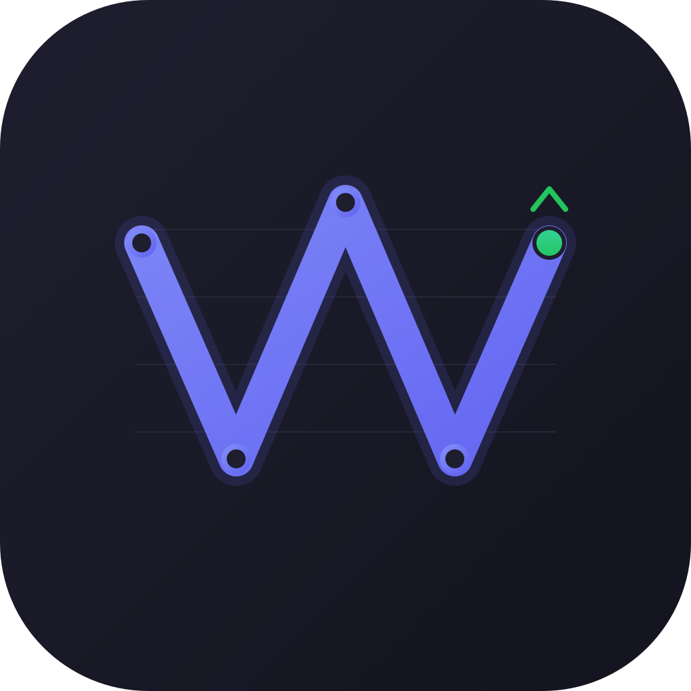

<div align="center">
  
  <h1>WeightTrack</h1>
  <p>Track your weight, body measurements and cycle. Everything stays on your phone.</p>

  
  
  
  
</div>

## Features

- [x] Several profiles on one phone
- [x] Weigh-ins, with the change since last time
- [x] Body measurements
- [x] Cycle tracking: phases, and how they affect your weight
- [x] Charts with variation, minimum and maximum
- [x] Export your data and restore a backup
- [x] No account, nothing sent anywhere: data stays on the device
- [x] Entirely open source

## Run it

```bash
npm install
npx expo start      # Android, iOS or web
```

## Feedback and contributions

***All contributions are very welcome!***

- Bug reports and feature requests go [here](https://github.com/matteogalfre/WeightTrack/issues). The forms tell you what to include.
- Developers: fork the project and open a pull request.

## Translation

The interface is in French for now. An English version, or any other language, is very welcome: open an issue and we'll set it up together.

## License

WeightTrack is licensed under the [GNU General Public License v3](LICENSE): you can use, study, change and share it, as long as your version stays open too.
